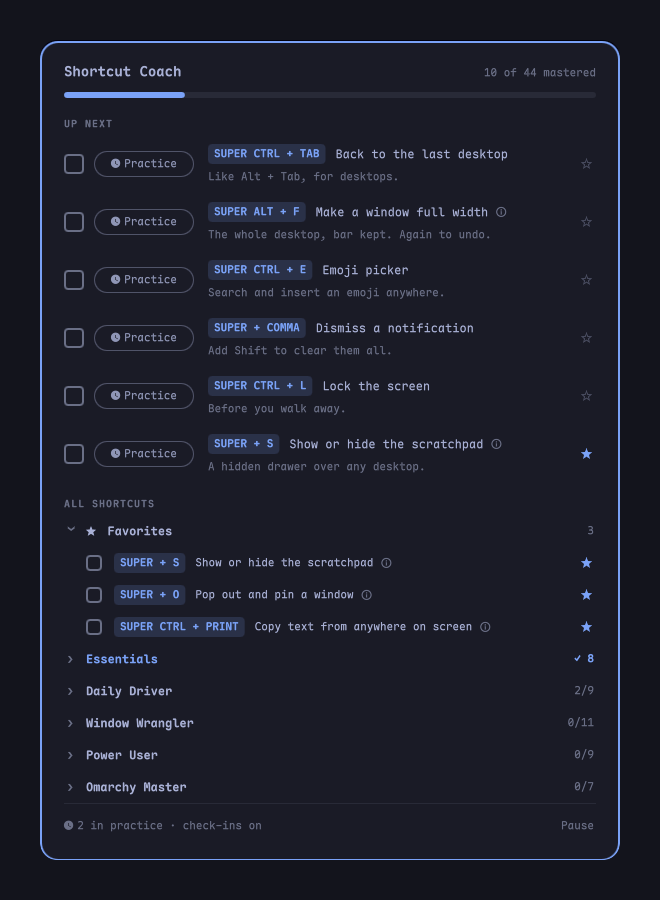

# Shortcut Coach

Learn Omarchy's keyboard shortcuts a few at a time, without leaving your work.



A cap icon in the Omarchy bar opens a short list of shortcuts to learn next.
Know one already? Tick it (there's confetti). Not sure yet? Press
**Practice**: you try it once, and it comes back as a small check-in card
while you work, at growing intervals, until it sticks.

> **Status:** early release, being tested on a daily-driver Omarchy machine.
> Expect changes.

## Why

Omarchy is built to be driven from the keyboard, and it has well over a
hundred bindings. `Super + K` lists them all, which is great for looking one
up and hopeless for learning them: a list of 150 shortcuts teaches you none.

What works for learning anything like this is well studied: small batches,
recalling instead of re-reading, and practice spread out over days rather
than crammed into one sitting. Shortcut Coach puts that into the bar, where
you already look, instead of in a separate course or game you have to sit
down for. See [docs/RESEARCH.md](docs/RESEARCH.md) for the method and the
studies behind it.

## Install

```bash
omarchy plugin add https://github.com/pbarnhill2/omarchy-shortcut-coach --enable
```

The cap icon (󰑴) appears on the right of the bar. Click it to start.

## How it works

**Up next** shows six shortcuts, Essentials first. Each row has two choices:

- **☐ Checkbox:** you know it. It's marked as known for good. An Undo line
  appears for a few seconds in case it was a slip.
- **󰥔 Practice:** you're not sure. Try it once right away, then it steps
  aside and comes back for quick check-ins.

Star (☆) any shortcut to keep it in **Favorites**, your own cheat sheet at
the top of the list. Some shortcuts have an ⓘ that opens a fuller
explanation, for ideas a one-line tip can't carry (the scratchpad, groups,
pop-out versus float).

**All shortcuts** lists every lesson in five sections: Essentials, Daily
Driver, Window Wrangler, Power User and Omarchy Master. Nothing is locked.
Open a section to tick anything you already know, or press **I know these**
to tick the whole section. Finishing a section gets a banner and a burst of
confetti.

Keys come from your live bindings (`omarchy-menu-keybindings --print`), so
if you've rebound something, the coach shows your keys. Lessons for
shortcuts you don't have are skipped.

### Practice and check-ins

After you try a shortcut, it comes back as a small card under the bar:
*"Do you remember how to… float a window?"*

| Check-in | 1 | 2 | 3 | 4 | 5 | 6 |
|---|---|---|---|---|---|---|
| Comes back after | 10 min | 1 hour | 1 day | 4 days | 2 weeks | 6 weeks |

- **Remembered** moves it to the next, longer gap. Pass the sixth and it's
  locked in (marked as known).
- **Show me** reveals the keys so you can try them, then asks again in 10
  minutes and steps it back one gap (two from the 2-week check on). Three
  misses mark it *tricky*.
- **Ignored** cards fade after 45 seconds and come back in 15 minutes,
  without moving a step.

Check-ins are built not to get in your way. They wait for a pause in your
typing, come at least 15 minutes apart and at most 8 a day, never take
keyboard focus, and skip fullscreen apps and time away from the computer.
**Pause** at the bottom of the panel stops them, for meetings.

## Add your own lessons

The `shortcut-coach` script in the plugin folder manages everything, so you,
a script, or an AI agent working on your machine can add lessons. Your own
lessons go to the front of the queue.

```bash
coach=~/.config/omarchy/plugins/pbarnhill.shortcut-coach/shortcut-coach

$coach add "SUPER + H" "Open my notes" "Bound in bindings.lua"
$coach list               # up next
$coach list --all         # every section, with practice progress
$coach done <id>          # mark as known
$coach undo <id>          # bring one back
$coach later <id>         # start practice
$coach done-section 2     # tick a whole section
$coach fav <id>           # star it (your favorites list)
$coach pause on           # pause check-ins
$coach batch 8            # show 8 in up next (default 6)
$coach reset --yes        # start over (keeps lessons you added)
```

Run `$coach help` for the full list.

## Privacy

Everything stays on your machine. Progress lives in
`~/.local/state/omarchy-shortcut-coach.json`, with a daily backup beside it
(`.bak`); updating the plugin keeps your progress. The plugin makes no network
requests and records nothing about what you type; it only checks whether
you've been idle for a few seconds, using the same Wayland idle signal as
Omarchy's screen lock.

## Uninstall

```bash
omarchy plugin remove pbarnhill.shortcut-coach
rm -f ~/.local/state/omarchy-shortcut-coach.json*
```

## License

MIT. See [LICENSE](LICENSE).
